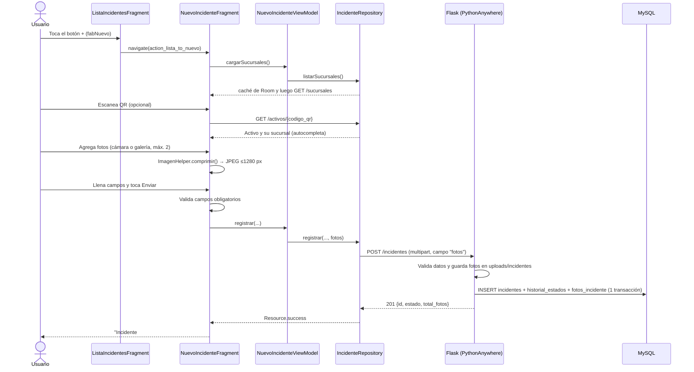

# Flujo de registro de un incidente

Recorrido completo desde que el usuario abre el formulario **Nuevo incidente** en la app
hasta que el incidente y sus fotos quedan guardados en el servidor
(`https://pokemonsac.pythonanywhere.com/`).

## Resumen



---

## 1. Abrir el formulario

**Archivo:** `ui/fragments/ListaIncidentesFragment.java`

- La lista de incidentes muestra el botón flotante **+** (`fabNuevo`) según el rol
  (`configurarSegunRol()`):

  | Rol            | ¿Ve el botón +? |
  |----------------|-----------------|
  | Solicitante    | Sí              |
  | Administrador  | Sí              |
  | Técnico        | No              |

- Al tocarlo se navega con `action_lista_to_nuevo` (definida en `res/navigation/nav_graph.xml`)
  hacia `NuevoIncidenteFragment`.

## 2. Preparar el formulario

**Archivo:** `ui/fragments/NuevoIncidenteFragment.java` → `onViewCreated()`

1. Crea el `NuevoIncidenteViewModel`.
2. Llena el combo **Categoría** con: `Red, Hardware, Software, Acceso, Impresora, Otro`.
3. Conecta los botones:
   - `btnEscanear` → `escanearEquipo()`
   - `btnAgregarFoto` → `elegirOrigenFoto()`
   - `btnEnviar` → `enviar()`
4. Empieza a observar los `LiveData`: sucursales, activo, fotos y registro.
5. Pide las sucursales: `viewModel.cargarSucursales()`.

### Carga de sucursales

**Archivo:** `repository/IncidenteRepository.java` → `listarSucursales()`

1. Primero lee las sucursales guardadas en **Room** (`sucursalDao().listar()`) y las muestra
   de inmediato (sirve sin internet).
2. Luego llama a `GET /sucursales`. Si responde bien, actualiza la caché en Room y el combo.
3. Si falla y no hay caché, muestra *"No se pudieron cargar las sucursales"*.

> El token JWT lo agrega automáticamente el `AuthInterceptor` de `network/RetrofitClient.java`
> (`Authorization: Bearer <token>`) en todas las peticiones.

## 3. Escanear el equipo (opcional)

**Métodos:** `escanearEquipo()` → `viewModel.codigoEscaneado()` → `repository.buscarActivo()`

1. Abre el lector **ZXing** (solo códigos QR).
2. Con el código leído llama a `GET /activos/{codigo_qr}`.
3. Resultado:
   - **Encontrado:** muestra `código · nombre` y **selecciona automáticamente la sucursal**
     donde está el activo (`seleccionarSucursal()`).
   - **No existe (404):** limpia el código y muestra el error.
   - **Sin conexión:** conserva el código y muestra *"(se validará al sincronizar)"*.

## 4. Agregar fotos (máximo 2)

**Métodos:** `elegirOrigenFoto()` → `abrirCamara()` / `elegirFoto` → `procesarFoto()`

1. Si ya hay 2 fotos, avisa *"Solo se permiten 2 fotos"*.
2. Muestra un diálogo **Cámara / Galería**:
   - **Cámara:** pide el permiso `CAMERA` si falta. `ImagenHelper.crearUriCamara()` crea
     `files/fotos/camara_<hora>.jpg` (vía `FileProvider`) y la cámara guarda ahí la foto.
   - **Galería:** abre el selector `image/*`.
3. `procesarFoto()` corre en un hilo aparte y llama a `ImagenHelper.comprimir()`:
   - Reduce la imagen a **máximo 1280 px** por lado.
   - La guarda como **JPEG al 80 %** en `files/fotos/foto_<hora>.jpg`.
   - Devuelve la ruta del archivo.
4. `viewModel.agregarFoto(ruta)` la agrega a la lista y el formulario muestra la miniatura
   con su botón **Quitar**. El botón cambia a *"Agregar foto (1/2)"*.

## 5. Enviar: validación en la app

**Método:** `enviar()`

Lee los campos y valida que estén completos:

| Campo        | Mensaje si falta                     |
|--------------|--------------------------------------|
| Título       | Ingrese el título del incidente      |
| Descripción  | Ingrese la descripción detallada     |
| Categoría    | Seleccione la categoría              |
| Sucursal     | Seleccione la sucursal               |
| Prioridad    | (texto de error bajo los chips)      |

Si falta alguno muestra *"Complete todos los campos obligatorios"* y no envía.
Si todo está bien llama a `viewModel.registrar(titulo, descripcion, categoria, prioridad, sucursal)`,
que agrega el código QR, el nombre del activo y las rutas de las fotos.

## 6. Armar y enviar la petición

**Archivo:** `repository/IncidenteRepository.java` → `registrar()` y `crearLlamadaRegistro()`

1. Publica `Resource.loading` → el botón muestra **"Enviando..."** con el indicador de progreso.
2. Arma un formulario **multipart/form-data**:

   | Parte         | Contenido                                   |
   |---------------|---------------------------------------------|
   | `titulo`      | texto                                       |
   | `descripcion` | texto                                       |
   | `categoria`   | texto                                       |
   | `prioridad`   | `Alta` / `Media` / `Baja`                   |
   | `id_sucursal` | id de la sucursal                           |
   | `codigo_qr`   | código escaneado o vacío                    |
   | `fotos`       | cada foto como archivo `image/jpeg` (0 a 2) |

3. Lo envía con `ApiService.registrarIncidente()` → **`POST /incidentes`**.
   Tiempo límite de subida: 60 s (`writeTimeout`).

## 7. El servidor procesa el registro

**Archivo del servidor:** `/home/PokemonSAC/routes/incidente.py` → `registrar()`

1. `@jwt_token_requerido` valida el token y obtiene `usuario_id`, `rol` e `id_empresa`.
   Sin token o con token vencido responde **401**.
2. Valida los datos obligatorios, la categoría y la prioridad → **400** si algo está mal.
3. Toma los archivos recibidos (`request.files.items(multi=True)`, cualquier nombre de campo)
   y valida que no sean más de 2.
4. Guarda cada foto en **`/home/PokemonSAC/uploads/incidentes/`** con un nombre único
   `<uuid>.jpg` (extensiones permitidas: jpg, jpeg, png, webp).
5. Llama a `Incidente.registrar()` (`models/incidente.py`), que en **una sola transacción**:
   1. Verifica que la sucursal pertenezca a la empresa del usuario.
   2. Si hay código QR, busca el activo en `activos_ti` (debe ser de la misma empresa).
   3. `INSERT` en **`incidentes`** con estado `Abierto` y `fecha_registro = NOW()`.
   4. `INSERT` en **`historial_estados`**: `NULL → Abierto`, *"Registro del incidente"*.
   5. `INSERT` en **`fotos_incidente`**: una fila por foto con el nombre del archivo.
   6. `COMMIT`. Si algo falla hace `ROLLBACK` y **borra las fotos ya guardadas** del disco.
6. Responde **201**:

   ```json
   {
     "status": true,
     "data": { "id": 15, "estado": "Abierto", "total_fotos": 2 },
     "message": "Incidente #15 registrado correctamente"
   }
   ```

## 8. La app recibe la respuesta

**Archivos:** `IncidenteRepository.registrar()` → `NuevoIncidenteFragment.observarRegistro()`

| Caso                         | Qué pasa                                                                                         |
|------------------------------|--------------------------------------------------------------------------------------------------|
| **201 – éxito**              | Borra las fotos temporales del celular, muestra *"Incidente #INC-0015 registrado correctamente"* y vuelve a la lista. |
| **401 – sesión vencida**     | Muestra *"Su sesión expiró, ingrese nuevamente"* y manda al login.                               |
| **400 / 500 – error**        | Muestra *"No se pudo registrar: \<mensaje del servidor\>"* y se queda en el formulario.         |
| **Sin conexión**             | Guarda todo en Room (`solicitudes_pendientes`, fotos como rutas separadas por `\|`), muestra *"Sin conexión: el incidente se guardó como Pendiente de sincronización"* y vuelve a la lista. |

### Sincronización de pendientes

`IncidenteRepository.sincronizarPendientes()` reenvía después cada solicitud pendiente con el
mismo `POST /incidentes`. Si el servidor la acepta, la elimina de Room; si la rechaza, la marca
como *"Error al sincronizar"*.

---

## Dónde verificar que se guardó

| Qué               | Dónde                                                                   |
|-------------------|-------------------------------------------------------------------------|
| Incidente         | Tabla `incidentes` (BD `jcachay$dambgr3`)                               |
| Historial inicial | Tabla `historial_estados`                                               |
| Nombre de fotos   | Tabla `fotos_incidente` (`ruta_archivo`)                                |
| Archivos de fotos | PythonAnywhere → `/home/PokemonSAC/uploads/incidentes/`                 |
| Ver una foto      | `GET /incidentes/fotos/<nombre>` con el token (así la carga Glide en `ImagenHelper.origenFoto()`) |
| Respuesta         | `data.total_fotos` debe ser igual a la cantidad de fotos enviadas       |
